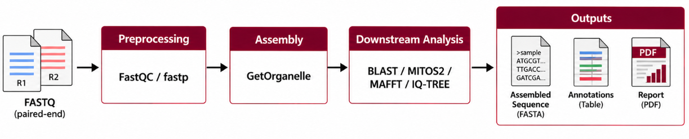

# MitoPipeline (mitogenome-batch-processor)
MitoPipeline is a reproducible Snakemake/Python workflow for assembly and analysis of mitogenomes from paired-end and whole-genome sequencing reads. This pipeline exists in a broader context of ecological surveying of freshwater fish, and was designed to create a database of mitogenomes for freshwater fish (~140 samples). However, the pipeline's design focuses on reproducibility, error handling, reporting, and portability to future datasets and organism types and could be readily adapted for assemblies of different types of organisms.

# Table of Contents
- [Pipeline Overview](#pipeline-overview)
    + [Features](#features)
    + [Inputs](#inputs)
    + [Outputs](#outputs)
- [Dependencies](#dependencies)
- [Installation](#installation)
- [Setup](#setup)
    + [Input Directory](#input-directory)
    + [Config](#config)
    + [Manifest](#manifest)
- [Running the Pipeline](#running-the-pipeline)
- [Background](#background)
- [v0.2.0 Changelist](#v020-changelist)

# Pipeline Overview
## Features
MitoPipeline is a comprehensive workflow for both assembling genomes and reporting on their biological validity. MitoPipeline integrates the major stages of mitogenome analysis into a single configurable workflow:

 This pipeline takes raw paired-end format sequence data (in fastq.gz format) and returns the following:
- Genome assembled via `GetOrganelle` with annotations and phylogenetic comparisons.
- FastQC reports on sequence data.
- Metadata required for submitting to GenBank, SRA, and BioProject/BioSample.
- Detailed reports on sequence runs.

This pipeline features a number of abstraction techniques to increase the fidelity of intermediate scripts, maintainability, reproducibility, and logging. Namely:
- **Snakemake Orchestration:** Snakemake orchestration allows for the seamless integration of bioinformatic tools without having to worry about versions and conda environments. It ensures that users have fine grain control over the parallelization of tasks running across the pipeline to maximize resource usage.
- **Object-Oriented Design:** Individual tools within the pipeline are abstracted into API's that inherit from a `BaseTool` class. Expected behaviors of tools are codified beforehand so that addition/removal of tools is self-consistent. These API's are called in execution scripts that are ultimately managed by Snakemake. 
- **Robust Logging:** Logging is completed per-step and per-sample, with output to the console tightly controlled by Snakemake and execution scripts. This ensures that the console is not cluttered by the output of individual tools but is ultimately reflective of the scripts that Snakemake is currently running and errors that were run along the way. Logging is standardized by the `logging` package defined in base `Python`. 
- **Provenance Control and Error Handling:** Because of the standardization of tool behavior, the pipeline is able to intelligently self-regulate silent failures, crashes, and warnings to help with debugging of code and troubleshooting datasets that will not assemble.
- **Detailed Reporting:** Run metrics (including machine usage) alongside biological data and plausibility of the genome is reported in detailed pdf documents at the end of the run.

Alongside the software engineering practices implemented above, MitoPipeline implements a number of strategies to provide evidence refuting/supporting the biological validity of assembled mitogenomes:
- **Assembly Assessment and Rescue:** The assembled mitogenome is characterized and compared to expected metrics. If for some reason, the mitogenome does not meet these metrics, a comprehensive rescue protocol is started - hyperparameters for assembly are adjusted to correct for possible causes of failed, incomplete, or unacceptable assemblies. The outcome of this is detailed in the reports once the run is completed. 
- **FastQC Quality Assessments:** FastQC is run 3 times for a given sample - once before the sample is trimmed by `fastp`, once after the trimming is complete, and once `GetOrganelle` has finished its read recruitment step. 

# Dependencies

# Installation

# Setup

## Inputs

## Config

## Manifest

# Running the Pipeline

# Background
The goal of this project is the development of a pipeline which will batch process and assemble raw reads from samples of fish tissue into completed mitogenomes that comprise a reference database for freshwater fish species in Illinois. This reference database would ideally then be published to NCBI GenBank and compiled into a microbiology resource announcement. 

# v0.2.0 Changelist
> **v0.2.0:** This version represents a continuation of the work started in v0.1.0 and is a complete overhaul of the original project design. While the core functionality and deliverables are preserved, when v0.1.0 was executed on sequencing data: ~40% of the data assembled, with less than 10% reaching the end of the pipeline before crashing. Changelist:
> - **Complete Metadata Collection for BioProject, Biosample, SRA, and GenBank**
>   + The pipeline is able to aggregate metadata in order to create the required submittables for NCBI data archival.
>   + Hints for how to add missing metadata are generated at the end of a pipeline run.
> - **Improved Reporting Capability**
>   + More aesthetically pleasing reports that are easier and color-coded to identify problems with the job.
>   + A more dynamic methods section with robust metadata collection protocols.
>   + Added capability to run fastQC on reads recruited by GetOrganelle to help diagnose troublesome data.
>   + Reports also include specs from the machine that ran the pipeline.
> - **Better Repository Organization**
>   + Files are organized in folders by step number for easier maintenance and extension.
>   + All files and folders less ambiguously and generous in-code commenting/docstrings.
>   + All artifacts required for publication are contained in a folder called "aggregated_data" in the output folder.
> - **Seed Selection**
>   + Fully implemented a canonical fallback sequence for biomarkers based on coverage to use for read recruitment in assembly.
>   + Supports assembly rescue capability.
> - **BLAST Phylogeny Inference**
>   + A local BLAST database is constructed to create phylogenies. 
>   + This database contains entries for *Actinopterygii* only to save space (can be changed in config).
> - **Improved Rescue Capability**
>   + <ins>Original Design:</ins> Say a hypothetical assembly would fail. v0.1.0 would take reads recruited by GetOrganelle and run them through MiniMap2 to obtain additional sequences from the original pool of sequences. GetOrganelle would then run on the originally recruited sequences and the new ones obtained by Minimap2 - this would not protect against (but instead reinforced) gaps in the genome. 
>   + <ins>New Design:</ins> Three different strategies are employed for rescue, done sequentially until a full genome is obtained or all fail. The first is the original design - this will help boost coverage of existing reads and help cut out noise. The second changes which seed is utilized, ensuring the seed isn't necessarily the issue with assembly. The third reads the full pool of reads again with the original seed used for the assembly but widens the k-mer list, raises target coverage, and allows more assembly rounds - assists with targeting complex or low-coverage regions.
> - **Improved Testing Capability**
>   + Test were written to assist with detecting edge cases and failures to detect regression when coding new sections of the pipeline and to prevent debugging on actual pipeline runs (which would take hours per run).
>   + As per Dr. Burns' advice, fixtures for quick testing were produced using Gargammel. These are small enough to upload to GitHub and can be used for a quick test of the pipeline before running on real data. 
>   + Test fixtures are simulated Illumina NGS sequencing reads of a completed *Danio rerio* mitogenome. Three different simulated datasets were produced: a complete genome, a genome with gaps in the middle, and one that is so broken that no assembly would be produced, ensuring the pipeline runs despite problematic datasets. 
> - **Robust Error Handling and Logging**
>   + Visbility for crashes and stages in the pipeline was difficult to track in v0.1.0. Logging provides both centralized (in a master log file) and decentralized (in log files designated to samples/steps) formatting allowing for thorough debugging of problematic reads.
>   + Errors and missing data are handled more intelligently preventing silent failures from crashing downstream steps.
